# Nourish — Your AI-Powered Nutrition & Fitness Companion

**Eat smarter. Move better. Build healthier habits.**

[Live Demo](https://nourish-xnmv.onrender.com/) · [GitHub Repository](https://github.com/aleenagibi/context-aware-nutrition-coach)

Nourish is an AI-powered nutrition and fitness companion designed to make everyday health decisions simpler. It brings together Generative AI, contextual personalisation, food-composition data, meal planning and activity tracking to help users make more informed decisions about what they eat and how they stay active.

Instead of functioning as just another calorie tracker, Nourish focuses on a more practical question:

> **What should I eat next to meet my nutritional goals using the food I have available?**

The application combines conversational AI with structured nutrition data to turn everyday food descriptions into useful, understandable and actionable guidance.

---

## Application Preview

### Sign in

<p align="center">
  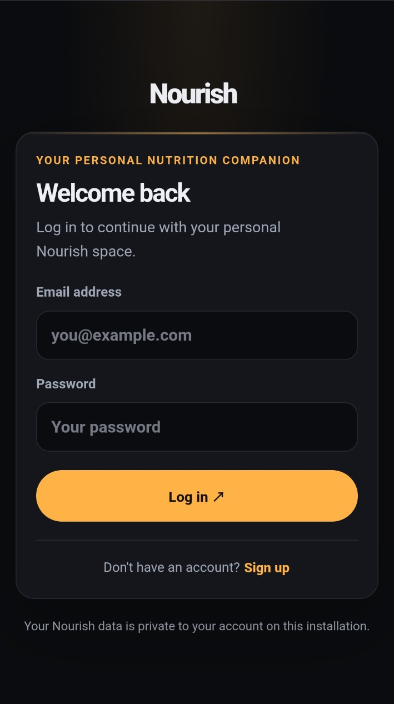
</p>

### Your daily nutrition dashboard

Track your nutritional progress, monitor your protein intake and discover meal suggestions based on your goals.

<p align="center">
  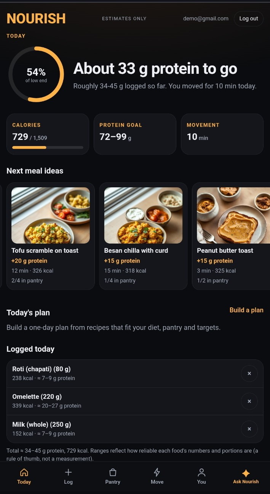
</p>

### Log meals using natural language

Describe your meal in everyday language. The AI-powered meal reader identifies food items and matches them against the food database before you confirm what should be saved.

<p align="center">
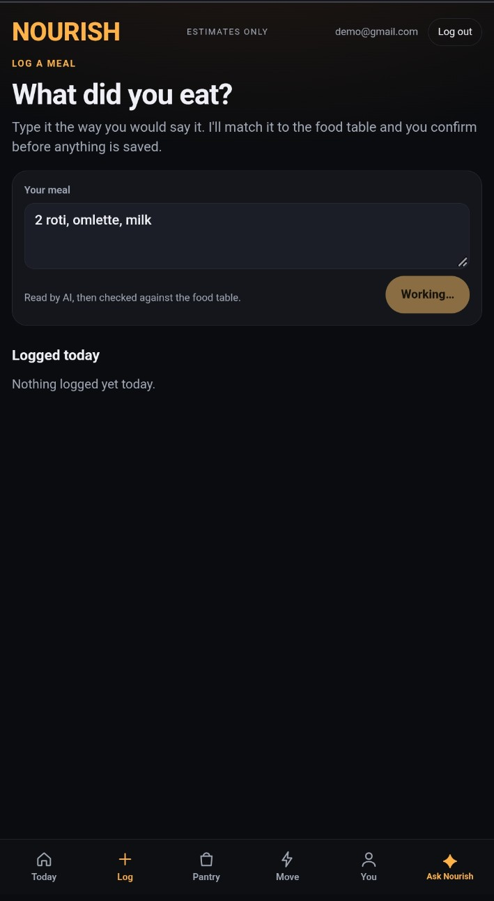
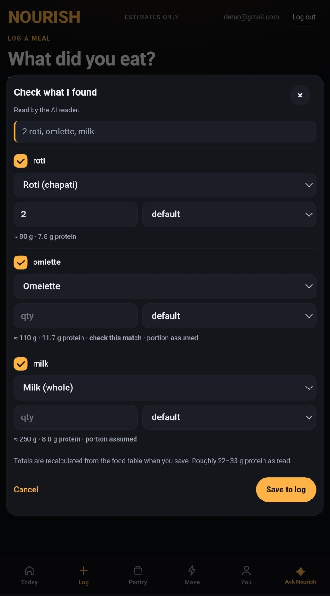
  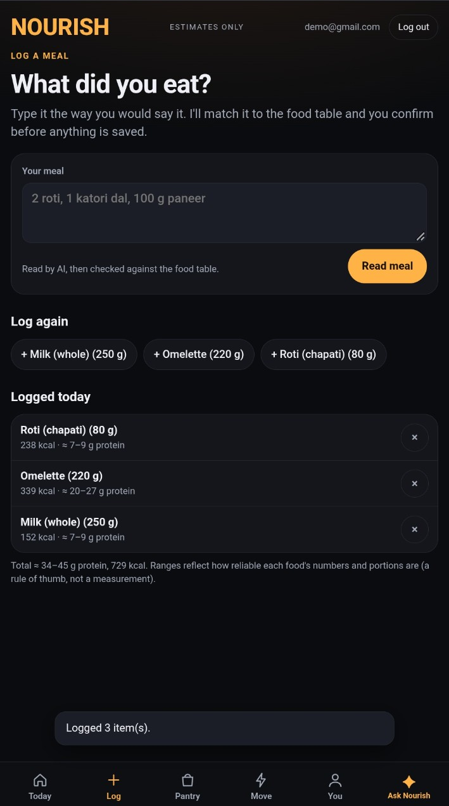
</p>

### Manage your pantry

Keep track of ingredients available at home. Pantry information helps Nourish suggest recipes that make use of ingredients you already have.

<p align="center">
  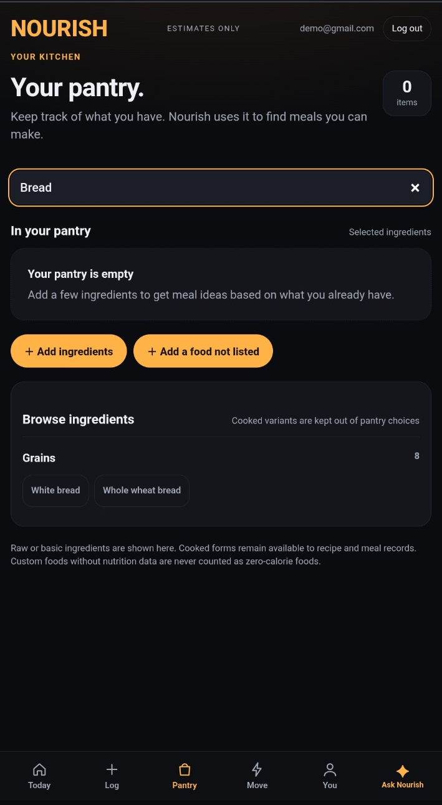
</p>

### Discover personalised recipes

Explore meal recommendations with nutritional information, ingredient availability, serving adjustments and preparation instructions.

<p align="center">
  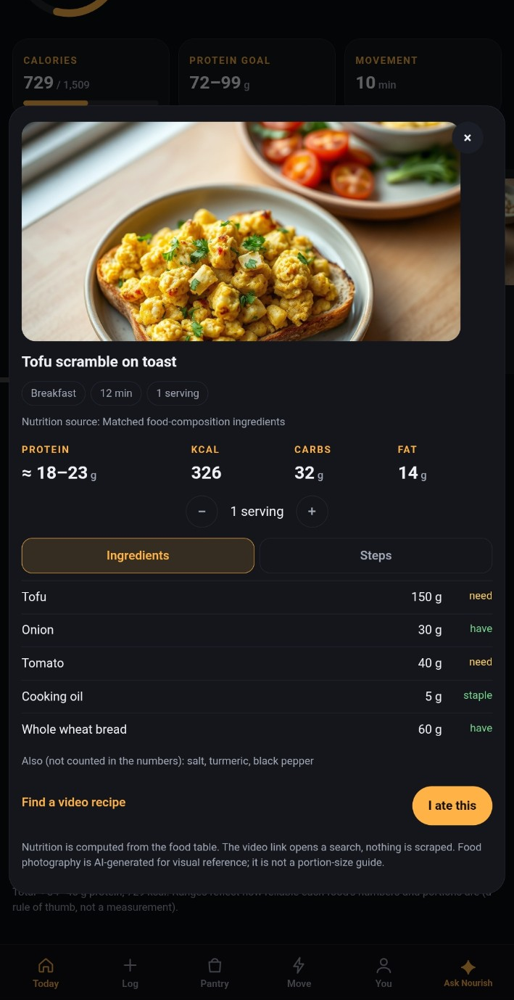
  &nbsp;&nbsp;
  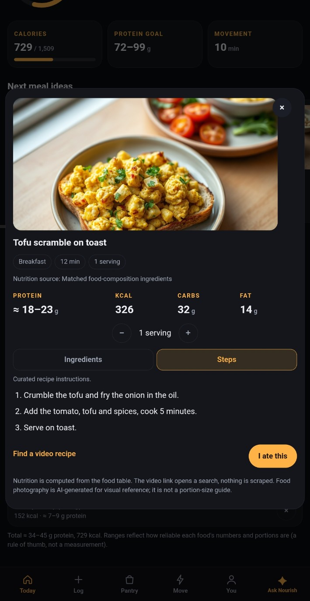
</p>

### Build a daily meal plan

Generate a one-day meal plan with breakfast, lunch, snacks and dinner based on your nutritional targets and food preferences.

<p align="center">
  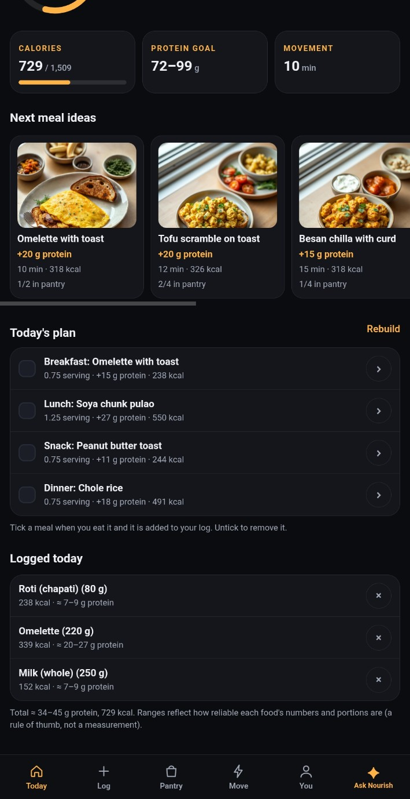
</p>

### Track physical activity

Record workouts manually or describe your activity naturally for AI-assisted workout interpretation.

<p align="center">
  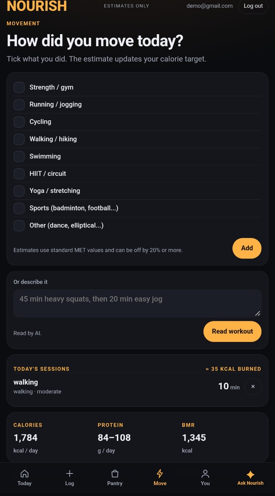
</p>

### Personalise your nutrition goals

Maintain your profile, including age, height, weight, activity level, food preferences and fitness goals.

<p align="center">
  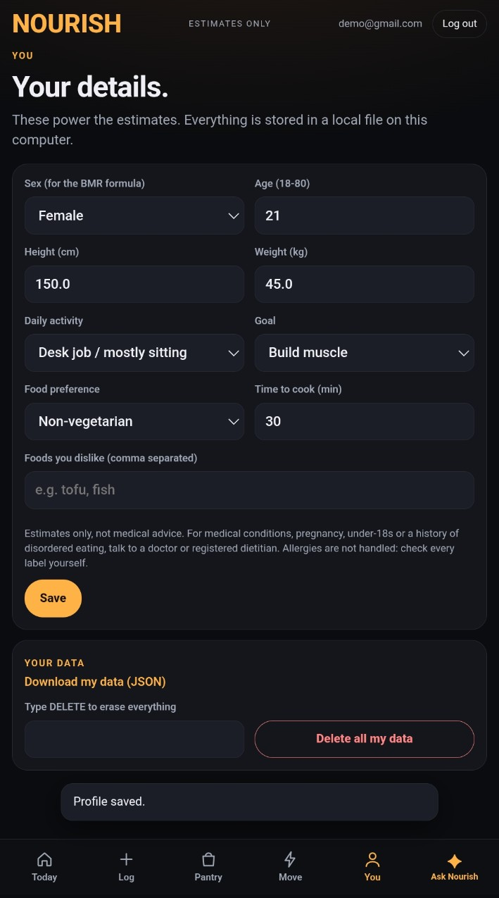
</p>

---

## Key Features

### 1. AI-Powered Nutrition Assistant

Nourish integrates a Large Language Model (LLM) through the Groq API to provide conversational nutrition and fitness assistance.

Users can ask questions about:

- Daily protein and calorie requirements.
- Food choices and meal combinations.
- Nutrition and fitness goals.
- Meal planning and available ingredients.
- General nutrition and workout guidance.

The assistant uses relevant application context when constructing prompts, helping generate responses that are more relevant than generic chatbot answers.

### 2. Natural-Language Meal Logging

Users do not need to search through long food lists or manually enter every food item.

They can describe a meal naturally, for example:

`2 roti, 1 katori dal, 100 g paneer`

The AI-powered meal reader interprets the description and identifies possible food items. Nourish then matches the identified foods against its structured food database.

Users can:

- Review the identified ingredients.
- Correct food matches.
- Adjust quantities and serving units.
- Review estimated nutritional values.
- Confirm the entries before saving.

The AI assists with interpreting the description; nutritional calculations are based on matched food-composition data rather than values generated directly by the LLM.

### 3. Context-Aware Meal Recommendations

Nourish recommends meals using information such as:

- Remaining daily protein requirements.
- Calorie targets.
- Dietary preferences.
- Disliked foods.
- Available pantry ingredients.
- Cooking time.

Recommendations include estimated protein, calories, preparation time and pantry availability.

### 4. AI-Generated Food Imagery

Nourish integrates Pollinations to generate food images from text prompts.

These images provide visual references for suggested meals and recipes. They are intended for presentation and inspiration, not as a way to determine actual portion sizes or nutritional values.

### 5. Personalised Meal Planning

Generate a one-day meal plan containing different meal categories.

The plan considers available recipes, dietary preferences and nutritional targets. Users can review individual meals and mark them as eaten to add them to their daily food log.

### 6. Pantry Management

Maintain a list of ingredients available at home.

Pantry information is used to:

- Identify recipes that match available ingredients.
- Highlight missing ingredients.
- Distinguish ingredients already available from those that need to be purchased.
- Support more practical meal recommendations.

### 7. Workout and Activity Tracking

Record physical activities such as:

- Strength training.
- Running and jogging.
- Cycling.
- Walking and hiking.
- Swimming.
- HIIT and circuit training.
- Yoga and stretching.
- Other activities.

Users can also describe a workout in natural language for AI-assisted interpretation.

Activity estimates use standard MET values and should be treated as approximations rather than precise measurements.

### 8. Personal Nutrition Dashboard

The dashboard brings important daily information together:

- Calorie intake and estimated daily target.
- Protein intake and target range.
- Remaining protein requirements.
- Movement duration.
- Suggested meals.
- Daily meal plan.
- Logged food entries.

Nourish uses ranges where appropriate to communicate uncertainty in food portions and nutritional estimates.

### 9. User Accounts and Personal Data

Nourish includes account-based authentication and user-specific application data.

Users can maintain their own nutrition profile, meal history, pantry, workout records and preferences.

Additional data controls include downloading personal data in JSON format and deleting account data.

---

## How Generative AI Powers Nourish

Generative AI is a core part of Nourish's interaction model. It allows users to communicate naturally instead of relying entirely on predefined forms and manual database searches.

| Component | Technology | Role |
|---|---|---|
| Conversational nutrition assistant | Groq-hosted LLM | Generates natural-language nutrition and fitness guidance |
| Natural-language meal interpretation | Groq-hosted LLM | Interprets meal descriptions and identifies food items |
| Context-aware prompt construction | Application context and prompt engineering | Supplies relevant user information to the model |
| Workout description interpretation | Groq-hosted LLM | Interprets natural-language workout descriptions |
| Food image generation | Pollinations | Generates food-related images from text prompts |

### Context-Aware AI Generation

A key feature of Nourish is that AI responses can incorporate relevant information from the application.

For example, when a user asks for a meal suggestion, relevant context can include their nutritional targets, food preferences and pantry ingredients.

The general workflow is:

1. The user submits a natural-language request.
2. The application retrieves relevant information from the user's data.
3. The backend constructs a context-aware prompt.
4. The prompt is sent to the LLM through Groq.
5. The model generates a response.
6. The application presents the generated content to the user.

This approach makes the assistant more relevant to the user's current situation.

### AI-Assisted Meal Interpretation

The meal logging workflow demonstrates how generative AI can be combined with structured data:

1. The user describes a meal in natural language.
2. The LLM interprets the description and identifies food items.
3. The application matches those items against the food-composition database.
4. The user reviews and corrects the suggested matches.
5. Nutritional values are calculated using the matched food data.
6. The confirmed meal is saved to the user's log.

**The LLM handles language understanding, while the structured food database handles nutritional calculations.**

### AI-Generated Food Images

Pollinations is used to generate food imagery from descriptive prompts. This adds a visual component to the meal recommendation and recipe experience without requiring a manually maintained image for every recipe.

---

## Application Architecture

Nourish follows a client-server architecture in which the Flask backend coordinates user interactions, application logic, database operations and external AI services.

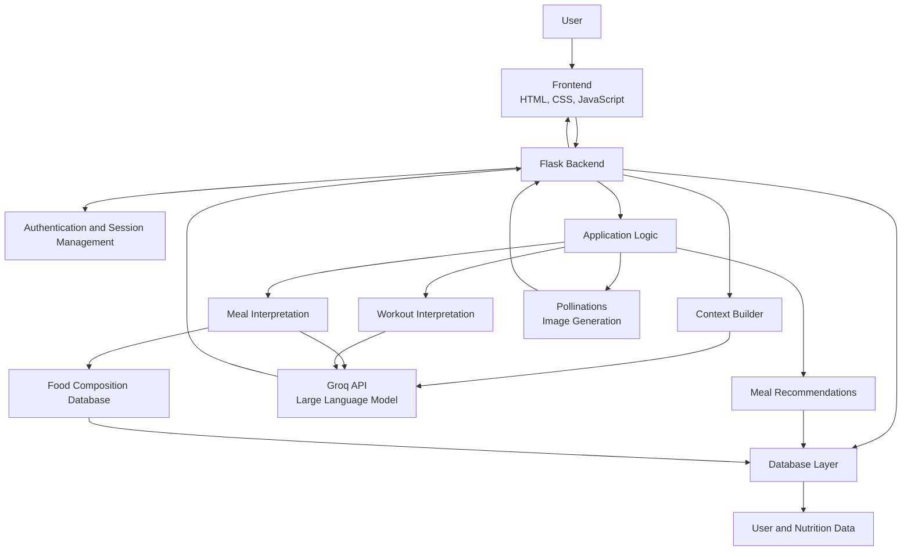

### Architecture Components

| Component | Responsibility |
|---|---|
| Frontend | User interface and interactions |
| Flask backend | Request handling, authentication and application logic |
| Context builder | Collects relevant information for AI prompts |
| Groq integration | LLM-based text generation and interpretation |
| Pollinations integration | AI-generated food imagery |
| Food-composition database | Structured nutritional information |
| Database layer | User accounts, profiles, meals, pantry and activity records |

---

## Technology Stack

| Layer | Technologies |
|---|---|
| Backend | Python, Flask |
| Frontend | HTML5, CSS3, JavaScript |
| Generative AI | Groq API, Large Language Models |
| Image Generation | Pollinations |
| Nutrition Data | Structured food-composition database |
| Database | PostgreSQL with SQLAlchemy 2.x and Alembic |
| Production Server | Gunicorn |
| Deployment | Render |
| Version Control | Git, GitHub |

---

## Getting Started

Follow these instructions to run Nourish locally.

### Prerequisites

- Python 3.10 or later
- pip
- Git
- A Groq API key
- Internet connection

### 1. Clone the repository

```bash
git clone https://github.com/aleenagibi/context-aware-nutrition-coach.git
cd context-aware-nutrition-coach
```

### 2. Create a virtual environment

```bash
python -m venv .venv
```

Activate the environment.

**Windows (PowerShell):**

```powershell
.venv\Scripts\Activate.ps1
```

**macOS / Linux:**

```bash
source .venv/bin/activate
```

### 3. Install dependencies

```bash
Copy `.env.example` to `.env` and configure `DATABASE_URL` for your PostgreSQL instance and `FLASK_SECRET_KEY` before running the migration commands below.

pip install -r requirements.txt
```

### 4. Configure environment variables

Create a `.env` file in the project root.

```env
GROQ_API_KEY=your_groq_api_key
SECRET_KEY=your_secret_key
```

Add any other environment variables required by your application configuration.

Do not commit your `.env` file or expose API credentials publicly.

### 5. Run the application

```bash
python app.py
```

Open the local address displayed by Flask in your browser.

---

## Project Structure

The application is organised around the Flask backend, supporting modules, templates and static frontend assets.

```text
context-aware-nutrition-coach/
│
├── app.py
├── requirements.txt
├── core/
│   ├── db.py
│   ├── store.py
│   └── ...
│
├── data/
│   └── ...
│
├── templates/
│   └── ...
│
├── static/
│   ├── css/
│   ├── js/
│   └── ...
│
└── docs/
    └── images/
        ├── login.png
        ├── dashboard.png
        ├── dashboard-empty.png
        ├── meal-entry.png
        ├── meal-confirmation.png
        ├── meal-log-confirmed.png
        ├── pantry.png
        ├── workout-tracking.png
        ├── profile.png
        ├── meal-plan.png
        ├── recipe-details.png
        └── recipe-steps.png
```

*The structure above highlights the main application areas; individual files may differ in the current repository.*

---

## Security, Privacy and Responsible AI

Nourish incorporates several considerations for handling user information and AI-generated content:

- Passwords are stored as hashes rather than plain text.
- Session-based authentication is used for account access.
- Sensitive configuration and API credentials are managed through environment variables.
- User-specific information is used to personalise application functionality.
- Users can download their data and request deletion through the application.
- AI-generated nutritional interpretations are reviewed against structured food data before being saved.
- Nutritional values and activity estimates are presented as estimates, not medical measurements.
- AI-generated food images are visual references, not indicators of actual serving sizes.

Nourish is intended for general wellness and informational purposes. It is not a substitute for professional medical advice or individualised clinical nutrition care.

---

## Future Improvements

Planned areas of development include:

- PostgreSQL persistence with SQLAlchemy, Alembic migrations and isolated personal-data schemas.
- Improved contextual retrieval for nutrition and fitness conversations.
- More flexible meal recommendations based on pantry contents and remaining nutritional targets.
- Expanded food-composition data and ingredient matching.
- Improved handling of ambiguous meal descriptions and portion estimates.
- Further enhancements to personalisation and activity tracking.

---

<p align="center">
  <strong>Nourish</strong><br>
  Making healthier decisions a little easier, one meal at a time.
</p>

<p align="center">
  <a href="https://github.com/aleenagibi">GitHub: @aleenagibi</a> ·
  <a href="https://github.com/aleenagibi/context-aware-nutrition-coach">Project Repository</a>
</p>
