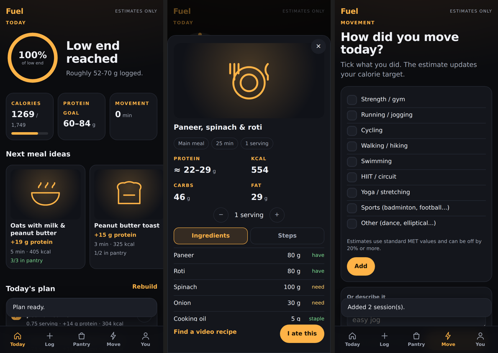
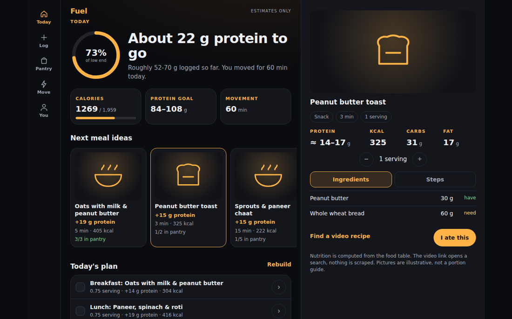

# Fuel: an AI protein & calorie planner (Flask + SQLite + Groq)

Answers one question: **"What should I eat next to reach my protein target with what I have?"**
It turns a workout and a typed meal into estimates, ranks recipes against your pantry and diet, and answers
follow-up questions with cited sources. **The LLM reads language and makes decisions; Python computes every number.**




## What it does
- **Today:** protein progress ring, next-meal ideas ranked by remaining protein, pantry coverage, diet and time of day; a one-day plan with tick-to-log checkboxes.
- **Log a meal:** type "2 roti, 1 katori dal, chutney". The LLM extracts names and quantities, Python matches them to the food table and converts units, and you confirm in an editable sheet before anything is saved. Unknown foods are never given numbers.
- **Pantry:** tick what you have; suggestions re-rank and show what you would still need.
- **Move:** tick activities (or describe them) for a calorie-target estimate.
- **Recipes:** ingredients with have/need marks, servings stepper, steps, and a video *search* link. Nutrition is computed from the ingredients.
- **Coach:** a tool-calling assistant (targets, food lookup, today's totals, recipe suggestions, cited knowledge-base search).
- **Responsive from 300 px:** bottom sheets on phones, dialogs on tablets, a side pane on desktop. Your data can be exported or deleted from the You tab.

## GenAI components
| Component | Where | Notes |
|---|---|---|
| Structured extraction (workouts, meals) | `core/llm.py` | JSON validated field by field; retries only when the *output* is bad; units outside an allow-list are dropped |
| Constrained matching | `core/mealparse.py`, `core/foods.py` | alias/partial/fuzzy matching, unit conversion; the model never supplies grams or nutrition |
| RAG with citations | `core/rag.py`, `data/knowledge.md` | BM25; the app checks every cited `[S#]` was actually retrieved |
| Tool-calling agent | `core/agent.py` | the user's diet is enforced inside the tools, not trusted to the model |
| Evaluation | `eval/` | LLM vs rule-based baselines, retrieval hit rate, agent checks |
| Optional LLM-drawn SVG art | `scripts/gen_svg_art.py` | output is sanitised by an allow-list before it is saved (`core/svgsafe.py`) |

## Run
```bash
python -m venv .venv
source .venv/bin/activate            # Windows PowerShell: .venv\Scripts\Activate.ps1
pip install -r requirements.txt
cp .env.example .env                 # Windows: copy .env.example .env, then put your Groq key in .env
python app.py                        # open http://127.0.0.1:5000
```
The database (`data/fuel.db`) is created and seeded on first run. Without a Groq key everything works except the coach;
meal and workout reading fall back to a simpler rule-based reader. Get a free key at console.groq.com and check there for current
model names and free-tier limits. The default is `openai/gpt-oss-120b`; set `GROQ_MODEL` to change it.

## Tests and evaluation
```bash
python tests/test_core.py      # 14: calculator, parsers, retrieval, LLM layer, agent (mock clients)
python tests/test_data.py      # 19: seed data, matching, units, recipes, ranking, plan, SVG safety, importer
python tests/test_app.py       # 16: routes, CSRF, logging, plan ticking, error paths (no network)
python tests/test_layout.py    # 1: browser check at 300-1280 px, needs `pip install -r requirements-dev.txt` and `playwright install chromium`
python eval/run_eval.py        # offline baselines;  add --llm to score the Groq extractors and the agent
```
Offline baseline results (the LLM column is for you to generate with `--llm`):

| Task | Rule-based baseline |
|---|---|
| Workout extraction (32 cases) | 66% exact match, F1 73% |
| Meal logging, clean phrasing (32) | 100% exact |
| Meal logging, messy phrasing (14) | 29% exact, F1 88%, grams within 25%: 61% |
| Retrieval (12 questions) | hit@1 83%, hit@3 100% |

The clean meal set is deliberately easy (100% says the pipeline works); the messy set (reversed order, Hinglish, compound dishes, "a couple of")
is where an LLM should help. All cases were written by the project author, and meal gold grams use the same unit table as the app,
so the meal eval tests parsing and matching, not whether a katori really weighs 150 g. Cases that hit a rate limit or a bad key are skipped, not counted as model errors.

## Data: what is and isn't verified
- `data/seed_foods.csv` (88 foods) and `data/seed_recipes.json` (34 recipes) were **written by hand from typical published values, not imported from a
  dataset, and not checked against a source**. A test confirms each row is internally consistent (calories ≈ 4P + 4C + 9F, fibre-aware), which catches typos
  but does not prove the values match USDA/IFCT/INDB.
- Every food has a `confidence` (high / medium / low). The 22 prepared dishes (dal tadka, chicken curry...) are low-confidence estimates. Confidence and
  whether a portion size was assumed set the **range** shown next to protein totals. Those percentages are a rule of thumb, not a measured error.
- Replace seed values with published data using `scripts/import_csv.py` (examples in its docstring): `--mode update` upgrades existing foods by exact name match
  and marks them `high`; `--mode add` imports new foods (hidden from vegetarians until you set a diet tag). **Check each dataset's licence** before redistributing a database that contains it.
- Diet tags on composite dishes are conservative guesses. **Allergies are not handled**: the app says so, and you must check labels yourself.
- Knowledge-base entries S1 and S8 were checked against the ISSN position stand; the other ten are paraphrases marked `unchecked`.

## Why nothing is scraped
Nutrition values must be traceable, recipe text and food photos are copyrighted, and scrapers break. So: nutrition comes from the table (importable from open
datasets), recipes are original short steps, "video recipe" is a search link (never a model-written URL), and pictures are optional files you add.

## Pictures
Built-in line icons are used by default. To add pictures, drop `static/img/foods/<recipe id>.webp` (or png/jpg/svg); the app picks them up with no code change.
- `python scripts/make_image_prompts.py` writes consistent prompts for the image generator of your choice (check its licence terms).
- `python scripts/gen_svg_art.py` asks the Groq LLM to draw a simple SVG per recipe (sanitised, review by eye).

## Limits
- Single-user and local: no accounts. Anyone who can open the app on your machine sees your data. Do not expose it to the internet as is.
- Not tested against the live Groq API in the sandbox it was built in. Try each AI feature once with your key and run `eval/run_eval.py --llm`.
- Estimates only, not medical advice. BMR and MET formulas carry 10-20% individual error. Not for under-18s, pregnancy, medical conditions or a history of disordered eating.
- Day boundaries use the server's local clock. Recipe/plan ranking weights are heuristics and are not tuned.
- Sheets and in-place updates need JavaScript; without it, pages still render and plain forms still work, but the meal-confirmation sheet does not.

## Layout
`app.py` routes and actions | `core/` db, foods, mealparse, suggest, store, calc, workout, llm, agent, rag, svgsafe |
`templates/` + `static/` UI | `data/` seeds + knowledge base | `scripts/` importer and image tools | `eval/` | `tests/`

## Theme
Colours are CSS variables at the top of `static/style.css`; change `--accent` and `--accent-2` to re-theme.

## Dataset integration and Pollinations food photography

The dataset integration adds the supplied INDB, recipe, serving-size, recipe-link,
UK/US food-composition, unit-reference and USDA nutrient-retention workbooks.
The original curated recipes are preserved; imported dataset recipes use IDs prefixed
with `dataset_`.

1. Put the nine original XLSX files in a folder named `source_datasets` (the supplied
   project bundle includes that folder).
2. Run `python scripts/import_nutrition_datasets.py --source-dir source_datasets`.
   The importer is safe to rerun: it updates the imported food rows and dataset recipes
   without deleting the original curated recipes.
3. Copy `.env.example` to `.env` and set `POLLINATIONS_API_KEY` to your Pollinations
   **secret** key (`sk_...`). Do not commit `.env` or expose the key in frontend code.
4. Start Fuel as usual with `python app.py`.

Food photos are generated on the first opening of a recipe detail view and cached in
`static/img/foods/`. Later views use the cached local image, so they do not call the API
again. The model can be changed with `POLLINATIONS_IMAGE_MODEL`. If the key is missing
or the API is unavailable, Fuel keeps its existing SVG fallback and remains usable.

### Nutrition and matching notes

- Recipe ingredient food codes are matched against UK/US food-composition codes first,
  then by exact normalized food name. No fuzzy matches or guessed nutrient values are
  inserted.
- INDB's per-serving recipe nutrition is used when present; otherwise Fuel calculates
  from matched ingredients.
- `data/nutrition/recipe_ingredient_coverage.json` lists recipes with ingredients that
  could not be matched or converted. Those ingredients are shown as not included in the
  ingredient-derived calculation.
- `data/nutrition/unmatched_ingredients.json` and `import_report.json` provide the audit.
- Generic cup/ml/spoon-to-gram conversions are estimates, not ingredient-specific
  densities. Units that cannot be converted safely are excluded from ingredient sums.
- USDA nutrient-retention factors are stored as reference data only; they are not applied
  again to nutrient values already supplied by the food-composition tables.


## Accounts and private user data

Fuel now requires an account before the app can be opened.

- Sign up with an email address and a password of at least 10 characters.
- Passwords are stored as Werkzeug password hashes, not plaintext.
- The first account created on an existing installation inherits the current local Fuel data.
- Each later account receives a separate SQLite database file under `data/users/`; its profile, pantry, custom foods, meal logs, workouts, plans and Ask Fuel chat are isolated from other accounts.
- The food and recipe catalogue is copied into each user's database and remains available to everyone.
- Account credentials are stored separately in `data/accounts.sqlite3`.
- Keep `data/accounts.sqlite3`, `data/users/` and `data/session.secret` private and include them in secure backups. Do not commit or publish them.

For a public HTTPS deployment, set a long random `FLASK_SECRET_KEY` and set `COOKIE_SECURE=true`. Do not run the production app with Flask debug mode enabled.

Password reset by email is not included because this project does not currently have an email delivery service configured. Users who forget their password need an administrator-assisted reset until an email provider is configured.
